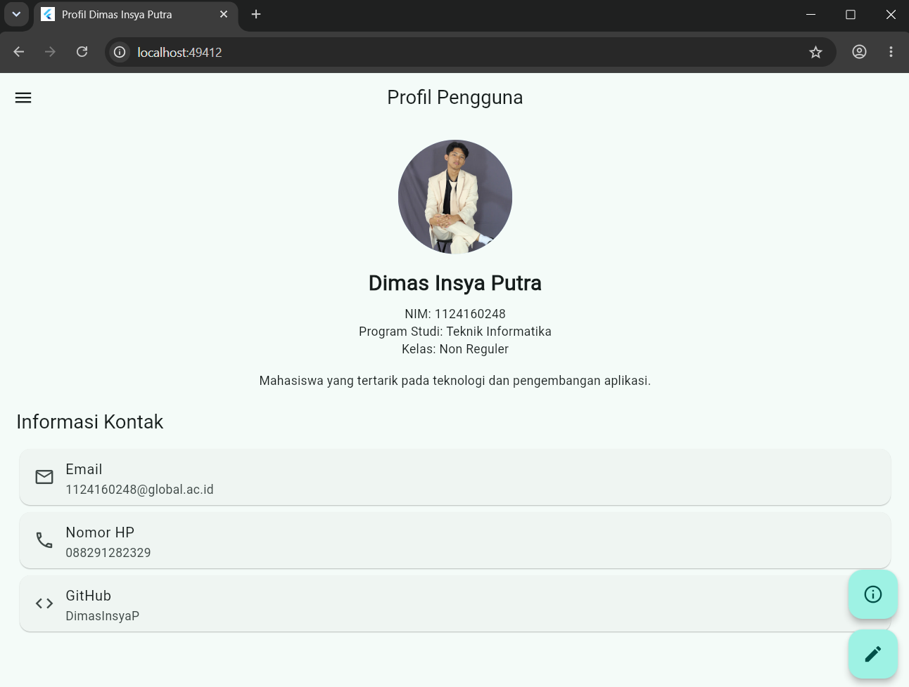
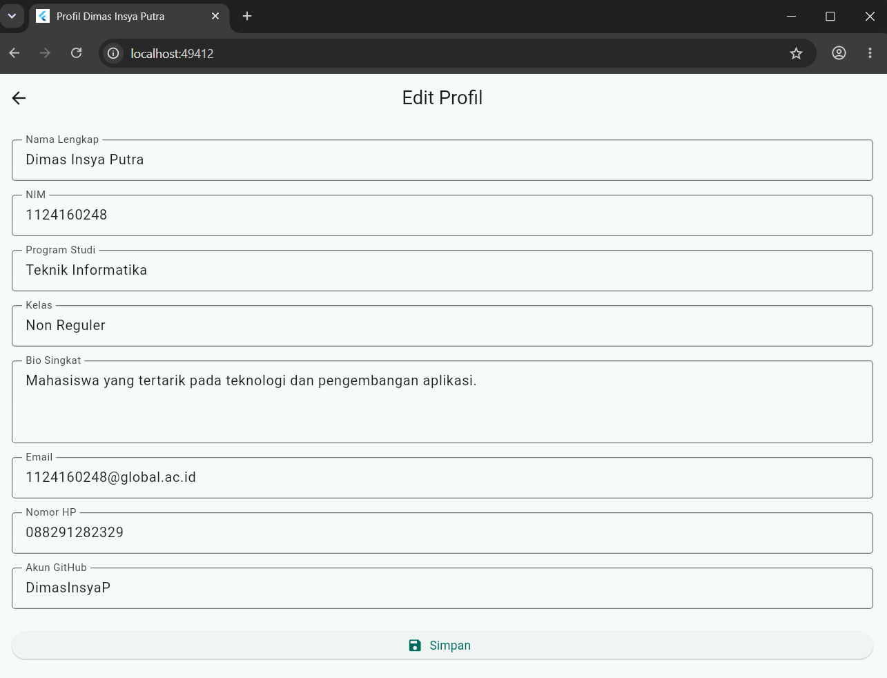

# Aplikasi Profil Pengguna

Aplikasi Profil Pengguna merupakan aplikasi berbasis Flutter yang dibuat untuk memenuhi tugas Ujian Tengah Semester mata kuliah Pemrograman Mobile. Aplikasi ini menyediakan fitur untuk menampilkan dan mengelola informasi profil pengguna.

## Identitas Mahasiswa

| Keterangan | Identitas |
|---|---|
| Nama | Dimas Insya Putra |
| NIM | 1124160248 |
| Program Studi | Teknik Informatika |
| Kelas | Non Reguler |
| Institusi | Global Institute |

## Video Demonstrasi

**Link YouTube:** 

## Screenshot Aplikasi

### 1. Halaman Profil



### 2. Halaman Edit Profil



## Daftar Fitur

1. **Halaman Profil**
   - Menampilkan nama, NIM, program studi, kelas, dan bio.
   - Menampilkan informasi kontak berupa email, nomor HP, dan GitHub.
   - Menampilkan foto profil.

2. **Edit Profil**
   - Mengubah informasi profil pengguna.
   - Form menampilkan data profil sebelumnya.
   - Validasi nama wajib diisi.
   - Validasi format email.
   - Validasi nomor HP berupa 10–13 digit angka.
   - Perubahan data langsung ditampilkan pada halaman profil.

3. **Halaman Tentang Saya**
   - Menampilkan daftar keahlian dan hobi.
   - Menampilkan riwayat pendidikan.
   - Menggunakan ListView.

4. **Navigasi**
   - Drawer untuk navigasi halaman.
   - FloatingActionButton untuk membuka halaman Edit Profil dan Tentang Saya.

5. **Tema Aplikasi**
   - Mendukung tema terang (Light Mode).
   - Mendukung tema gelap (Dark Mode).
   - Penggantian tema melalui switch di dalam aplikasi.

## Teknologi yang Digunakan

- Flutter
- Dart
- Material Design 3

## Cara Menjalankan Aplikasi

Pastikan Flutter dan Dart sudah terpasang pada komputer.

1. Clone repository:

   ```bash
   git clone https://github.com/DimasInsyaP/uts-pml-1124160248.git
   ```

2. Masuk ke folder project:

   ```bash
   cd uts-pml-1124160248/soal2-profil-app
   ```

3. Download dependencies:

   ```bash
   flutter pub get
   ```

4. Jalankan aplikasi:

   ```bash
   flutter run
   ```

## Struktur Project

```text
soal2-profil-app/
├── android/
├── lib/
│   ├── main.dart
│   ├── screens/
│   │   ├── profile_page.dart
│   │   ├── edit_profile_page.dart
│   │   └── about_page.dart
│   └── widgets/
│       └── profile_avatar.dart
├── pubspec.yaml
└── README.md
```

---

**Dibuat oleh Dimas Insya Putra**  
Teknik Informatika – Global Institute
